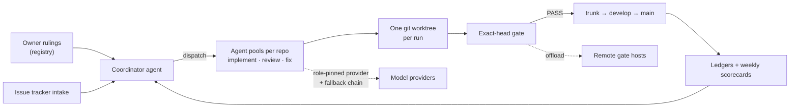

# What 20,000 agent runs taught me about agent infrastructure

From August to November 2026 I ran a fleet of AI coding agents that wrote most of the code
for a production LLM gateway I lead. Over seven weeks it completed **20,145 bounded agent
runs across five machines** and produced **4,511 merged pull requests**. Then I deleted the
custom dispatcher I'd written for it and moved onto the orchestrator's native one.

This post covers the parts that turned out to be infrastructure problems rather than
prompting problems: routing and quotas, state, merging, governance, verification, the command
lines agents drive, and cost. It also covers what broke, and the work I borrowed from.

The orchestrator is [Gas City](https://github.com/gastownhall/gascity), an open-source system
of agent pools, work items ("beads"), workflow formulas and scheduled orders. A deployment of
it is called a *city*. Everything here is about my city: how I configured and extended it,
and what the numbers said.

## The shape of the system

A coordinator agent reads intake and owner rulings, then dispatches work to agent pools.
Each run gets one work item, one git worktree, and one receipt with a verdict. Code reaches
the main branch only through a gate that tests the exact commit that will merge. Everything
leaves a row in a ledger, and the ledgers feed weekly scorecards that the coordinator reads.

## 1. Make the unit of work small and auditable

The first decision that mattered was refusing open-ended agent sessions. A *lane* is one
bounded job: implement this story, review that PR, fix these findings. It runs in its own
worktree and ends in a JSON receipt with a verdict: PASS, FAIL, BLOCKED or PREPARED.

That bounded unit is what made the rest measurable:

- 20,145 receipts, a peak of 1,475 runs in one day, and 6,094 in the busiest week.
- 11,112 model sessions, averaging about 10.6 minutes each, ≈1,960 lane-hours in total.
- Every run can be traced to its work item, branch, host, model and outcome.

If I were starting again, I'd build the receipt before the dispatcher.

## 2. Route models by role, and scope outages to roles

Agents in the city have roles — implementer, reviewer, fix-round, coordinator — and **each
role is pinned to a provider with an ordered fallback chain**. The city ended up with 22
provider configurations and 91 fallback chains.

Three things I learned:

- **Pin roles, not sessions.** A pin is a reviewed config change. When a model is better at
  review than implementation, that's one line.
- **An outage is scoped to its pinned roles.** When one provider ran out of quota, only the
  roles pinned to it fell back. Implementation kept moving while review shifted, or the other
  way round. Treating "the model" as a single dependency would have stopped the whole fleet.
- **Shadow before you switch.** A shadow router ran next to the live one and scored 2,733
  routing decisions against a cost/quality alternative. It agreed on 1,781, disagreed on 206,
  and had no comparison for the rest. That turns "should we route differently?" into a
  measured question. I didn't act on the disagreements and then re-measure, so it isn't proven
  to save anything yet.

Quota is a resource like CPU. Subscription logins rotate as each one drains, and effort
levels are pinned per provider, so a fallback model doesn't silently run at a different
reasoning budget.

## 3. Agent state lives somewhere real, and it will lie to you

Work items live in a versioned SQL store (Dolt) that the orchestrator uses as its database.
Agents claim them, update them and close them. This was the single most painful component,
for reasons that will sound familiar to anyone who has run stateful infrastructure:

- Under heavy write load, some writes and closes **reported success and didn't persist**.
- After a disk-full event the server **latched in an out-of-space state** until restarted.
- Workflow step records piled up into "husks" that slowed every query until reclaimed.

The fix that mattered wasn't in the store. It was a definition: **delivery is the commit on
the remote branch, not a closed work item.** Every "done" is checked against the git remote.
That one rule removed a whole class of "the agent says it finished" errors.

## 4. Merge only what you tested

At a few hundred agent PRs a week, the classic CI race shows up constantly: a PR passes
against one base and merges onto another. So agent PRs don't merge to the development branch
directly. They land on a **trunk**:

1. **Validate the exact head.** The gate tests the PR merged onto its base and records the
   verdict against that exact commit.
2. **Land by ref.** A PASS moves the trunk ref to that commit and nothing else. If anything
   moved underneath, the verdict is void and the PR is re-gated.
3. **Promote on a cadence.** Trunk is cut into the development branch, then into main, only
   at commits with a full-gate PASS.

**1,584 PRs landed on one trunk in 26 days.** I moved first-run gates to two idle machines
over ssh. A host skips itself above 0.85 load per core or under 8 GB free memory. The median
selective gate dropped from **14.4 minutes on the busy controller to 3.3–4.0 minutes** on the
remote hosts. The controller is freed to coordinate, which is what it's for.

The cost was real. Hundreds of promotion attempts failed in the merge queue before landing by
ref replaced it, and one merge rule was rewritten seven times in 34 hours. That's why the
rules now have change control (section 5).

## 5. Governance: every rule has an id and an enforcer

An autonomous fleet makes thousands of judgement calls, and the owner makes dozens of
decisions a week about how it should behave. Those decisions can't live in chat history or in
a prompt someone forgets to update. So **every owner decision becomes a numbered ruling with
an enforcer**: the script, switch or check that makes it true.

- 266 rulings so far, 238 of them active.
- **140 of the 238 active rulings are enforced by code.** The other 98 rely on judgement, and
  the registry says so.
- An hourly check flags rulings with no enforcer, expired rulings that are still referenced,
  and docs or prompts that still use wording a ruling retired.

The registry doesn't close the gap. About 41% of active rulings still rely on judgement. But
it makes the gap **visible and countable**, which is the precondition for a ratchet that only
lets that number go down.

## 6. Verification is the job

Agents are very good at saying "done". Most of the rules my fleet accumulated are about one
question: **what counts as proof?** The frame I use comes from Cursor's pstack verification
principles. Proof sits on a ladder of rungs, lowest first:

1. You said so.
2. You pointed at the line.
3. You walked the failure path and showed it can't be reached.
4. You ran it, and it fails loudly when it's wrong.
5. You reproduced it in the running app.

Every claim says which rung it reached, and every "tested" names its tier: unit, stubbed
end-to-end, or real stack.

In practice:

- **Each app has its own verify skill.** The gateway has a project-local verification skill
  with a **42-feature map**. Each feature entry covers how to launch the stack, how to drive the
  feature, and what counts as proof. A request-path pass must reach a real provider, because
  stubs and fixtures can't prove a live charge or persisted customer state. The map is
  maintained like code: 38 commits in six weeks, plus a linter, because a stale map is worse
  than none.
- **End-to-end and live suites, kept apart from unit tests.** Client suites in JavaScript and
  Python call the real API, alongside admin journey specs. Live suites cover the safety gate,
  media, the response cache, request history and routing. They're built on their own branch,
  so review queues don't block them, and each one closes its stories with a single acceptance
  run.
- **Every bug fix ships a test that fails on the old code.** It's red at `fix~1` and green at
  the fix. A test that passes on both doesn't count. Fakes of external tools model real
  behaviour, so a test checks the outcome, not the shape of the arguments. The review question
  is whether a plausible wrong implementation would still pass.
- **Proxies aren't proof.** A closed work item isn't delivery (section 3). An order that ran
  isn't an order that worked. A CI summary with zero checks reads as all green. UI changes ship
  with browser screenshots.
- **Metrics get ceilings.** A deterministic performance lab holds a checked-in ceiling per
  user journey. A rise is red, and a win lowers the ceiling in the same PR. The lab found a
  fixed 25 ms delay before every streamed response: time to first chunk went from 27.2 ms to
  1.17 ms in the lab.
- **A red trunk reverts itself.** When a test goes red on the trunk, a bisect names the culprit
  merge, and the merge is reverted if it hasn't been promoted yet.

The results that can be measured: the flake rate on the gateway's control-plane gate fell from
**7.27% to 0.73%**, and **344 tests that had never gated anything** were wired into every PR.
What's still missing is the number that matters most, an escape rate (see "What it cost").

## 7. Agents live on the command line, so design CLIs for them

The fleet does almost everything through command lines: the orchestrator, git, the GitHub CLI,
the work-item store and the city's own scripts. Many of the "agent mistakes" I chased were
really CLI traps:

- A dispatch command given an unknown id **created a new work item** instead of failing.
- A store update flag **replaced** a work item's notes when the agent expected it to append.
- A merge script's `--yes` **hung**, waiting on a merge queue.
- One tool accepted `@file` for a JSON argument, and its sibling refused it.

None of these show up in a model eval. A human would notice them once and remember. An agent
hits them again in every new session. The fix is in the tool: non-interactive by default,
`--dry-run` on anything that writes, machine-readable output, errors that say how to fix
themselves, idempotent re-runs, and `--help` with real examples. Every script the city adds
follows those rules. Where a tool can't be fixed, the trap is written into the agent's context
as a one-line rule with the safe invocation.

## 8. Watch the coordinator, not just the workers

The coordinating agent is the most expensive and the least observed. I scored its own tool
calls, failures and context use in rolling 7-day windows. Over two weeks its weekly calls fell
from 19,283 to 3,179 and its active hours from 77.8 to 8.9, at a steady failure rate of about
1–2 per 100 calls, by moving mechanical work into scheduled orders. Context restarts fell from
23 a day to 9. It is still the biggest single consumer of tokens.

## 9. Know when to delete your own layer

For seven weeks the fleet ran on a dispatcher I wrote on top of the orchestrator. In November
the orchestrator's native dispatch could do the job, so I ran a week-long trial, compared
outcomes, and **retired my dispatcher**. The first week on native dispatch ran 1,598 jobs
across 12 workflow formulas. Building the layer was the right call in August, and deleting it
was the right call in November.

## What it cost

| | |
|---|---|
| Tokens | ~46B across lane sessions |
| Lane-hours | ≈1,960 |
| List-price value of those tokens | ~$4,640 |
| Actually metered (most usage was on flat subscriptions) | ~$70 |
| Agent PRs closed unmerged | 8.3% (a floor: runs that never opened a PR leave no trace) |
| Runs graded WORKED | 82.6%, **graded by an LLM** |

The honest headline: **review capacity is the constraint, not agent capacity.** At this scale
humans don't review most PRs; gates and LLM review lenses do. So an LLM grader can't be the
quality measure. The next number I'm building is an escape rate: merged agent PRs later
reverted or fixed, sampled monthly.

## What broke

- **A sandboxing attempt crashed the host kernel.** Wrapping test runs in bubblewrap hit an
  AppArmor bug and panicked the main machine twice in one night. Tests went back to running
  unsandboxed in worktrees. *(See Sandboxing below.)*
- **A copied git directory hung every push.** I rsynced a `.git` while it was being written.
  Never copy a live repository.
- **False reds from host drift.** A remote host was missing one Python package, and every
  media test on it went red.
- **Memory.** One host was OOM-killed at four parallel test jobs. Each compile peaks near
  7.5 GB, so parallelism now comes from free memory, not core count.
- **Upstream.** I opened 10 PRs against the orchestrator, and none have merged yet. Running a
  fork 73 commits ahead was faster, and harder to give back.

## Sandboxing

After the kernel crash I tried again, more carefully: one evening on a gate host, as an
unprivileged user with no sudo, running the gateway's full control-plane suite (905 test files,
about 19,000 tests) under gVisor and under Firecracker. That host ran the same kernel that had
crashed, so the riskier probe went last and only while the host was idle.

- **Rootless gVisor didn't start.** Ubuntu's AppArmor restriction on unprivileged user
  namespaces moves `runsc` into a confined profile, then denies the setuid/setgid and the
  re-exec it needs. It failed cleanly on every platform. Even working, `runsc do` mounts the host
  read-only, so sandboxed code could still read every credential on the machine.
- **Rootless Firecracker worked.** It needed no network device, and the image was built with
  `mkfs.ext4 -d`. It booted to userspace in about a second. **The full suite took 920 s in the
  microVM against 840 s bare at equal CPUs: about 10% overhead.** Smaller suites cost 28–46%.
  Inside the VM there was no network, no host home directory and no SSH keys. The only extra
  failures came from tools missing in the image.
- **The overhead is memory translation, not CPU.** CPU and syscalls ran at parity. Random
  reads were 1.9x slower and first touch of memory 3.2x slower, the cost of nested paging over
  4K pages. Huge pages should recover most of it.
- **The finding that mattered most wasn't about VMs.** The gate user was in the `docker`
  group, which is root on that host, so every lane already had a path to root. A sandbox around
  the tests means little until the lane itself loses that. I've since taken the gate users out
  of the `docker` and `lxd` groups on both gate hosts; a fresh login there is refused by the
  Docker socket.

So the shape is **one microVM per test run, not per agent.** The agent needs network,
credentials and git push. The code it wrote, when run, needs none of them. Getting there takes
admin work the spike deliberately didn't do: durable KVM access for a dedicated user,
Firecracker's jailer and huge pages. Until then, lanes are
isolated by worktree and not sandboxed.

## What I borrowed

Very little of the method is original. Credit where it's due:

- **pstack, from Cursor's plugin pack** (MIT): the verification principles and proof ladder,
  the per-app verify skill with its feature map, the blast-radius check on small diffs, and the
  decision-trail log for unattended work. Its sibling guide on CLIs for agents shaped section 7.
- **Matt Pocock's skills:** red-green TDD, which became the "fails on the old code" rule;
  domain modelling with a glossary and ADRs; tracer-bullet tickets with blocking edges; grilling
  a plan before building it; and the retro that changes the agent's environment instead of the
  code.
- **Anthropic's "How we made claude.ai 3x faster"**: the hill-climbing loop, the perf baseline
  and the ratchet.

The pstack ports, the performance skills and my own are public in
[`hoomji/skills`](https://github.com/hoomji/skills): 66 skills across verification, harness
engineering, performance, review, prompting and orchestrator operations. Matt Pocock's I use
straight from his plugin.

## What I'd build next

1. Real sandboxed execution per lane, with network off by default and credentials never
   mounted.
2. An independent quality signal for agent output (escape rate), replacing the LLM grade.
3. A ratchet on the rulings registry: rulings enforced only by judgement may only decrease.
4. Admission control that schedules on memory and quota together, rather than on cores.

---

*Henry Tran builds agent infrastructure and LLM routing in Toronto.
[GitHub](https://github.com/hoomji) · [LinkedIn](https://www.linkedin.com/in/henry-tran58/)*
